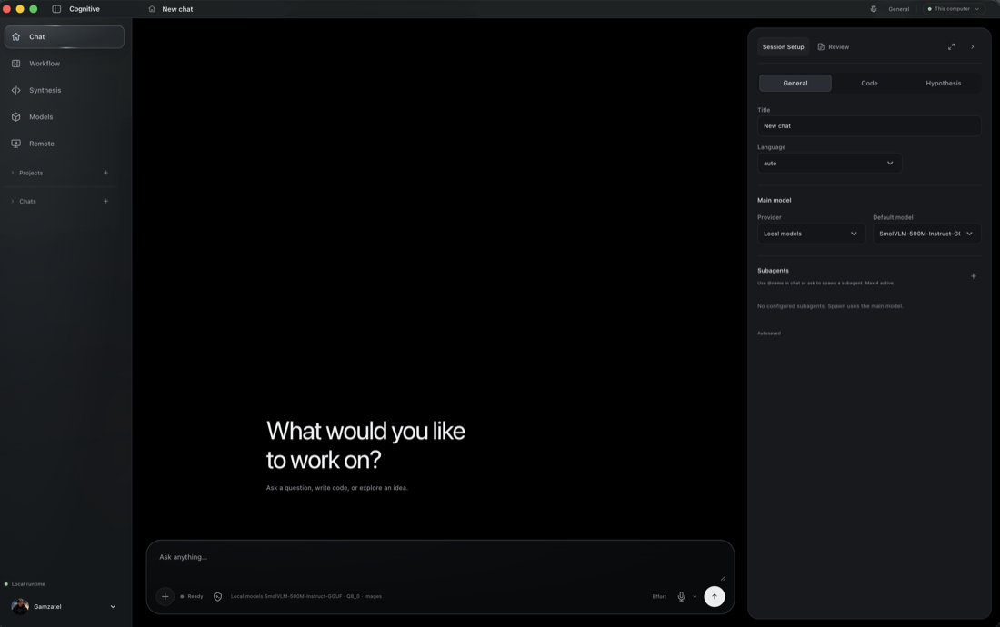
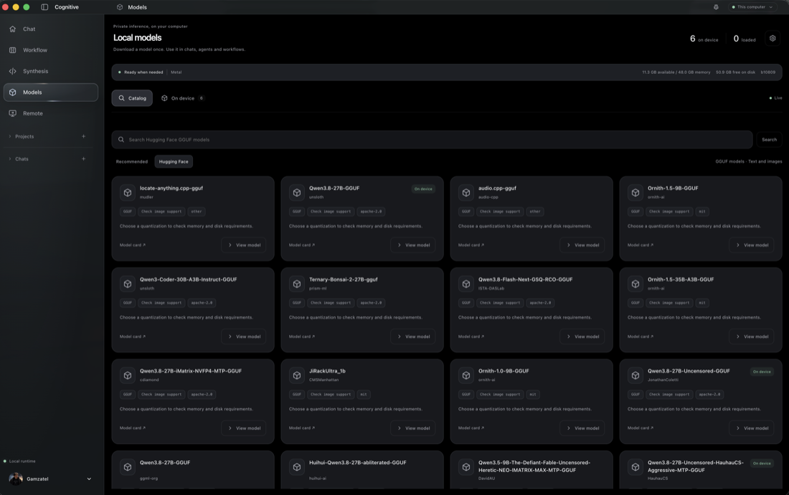
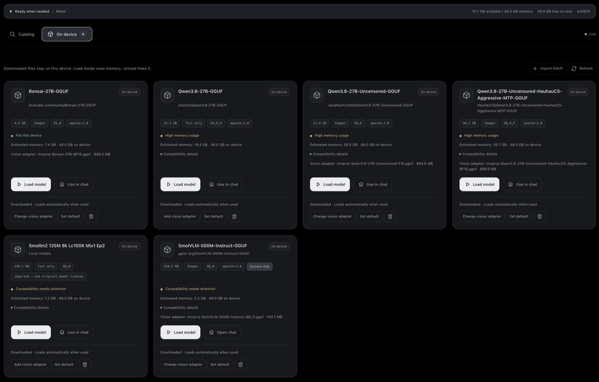
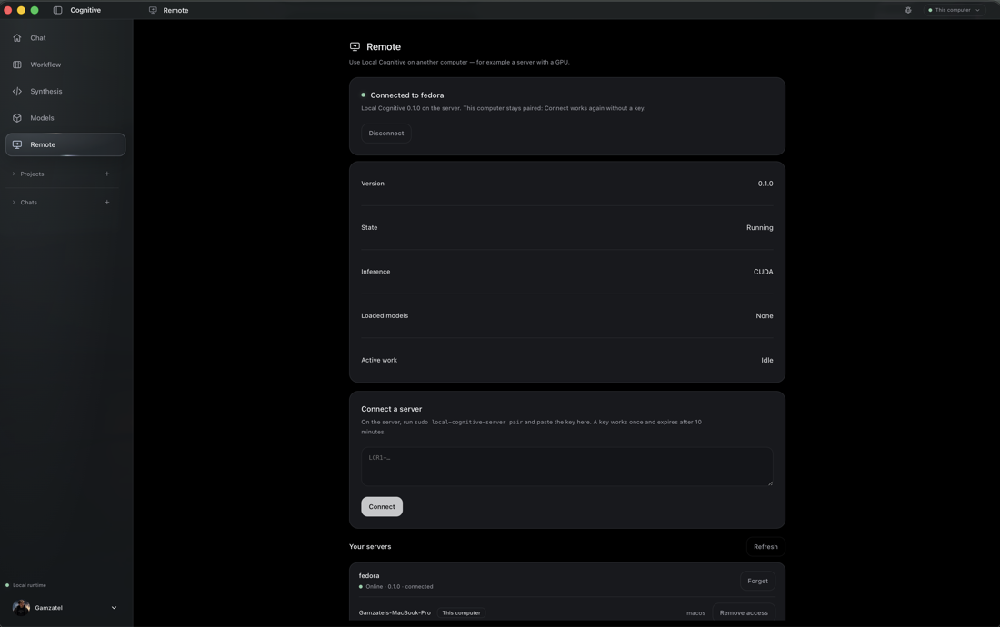
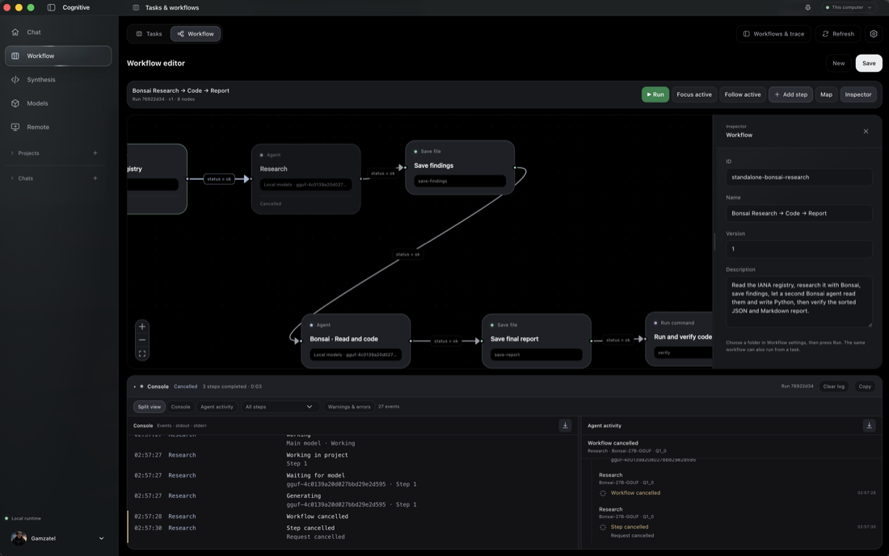
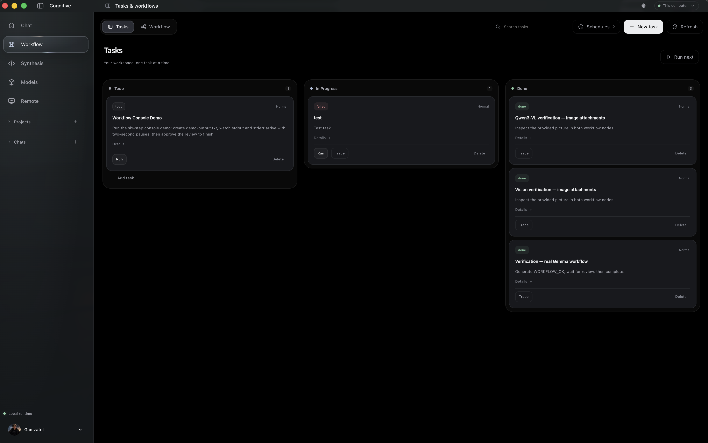
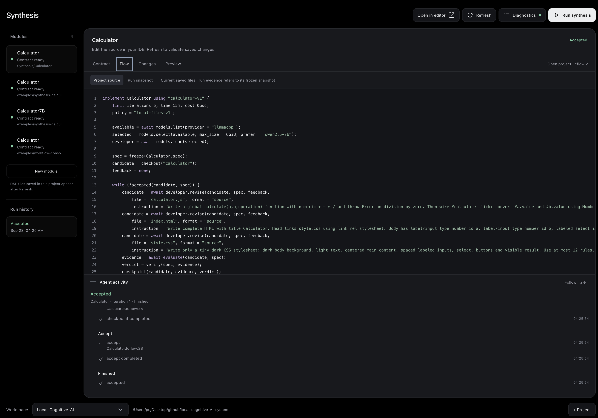
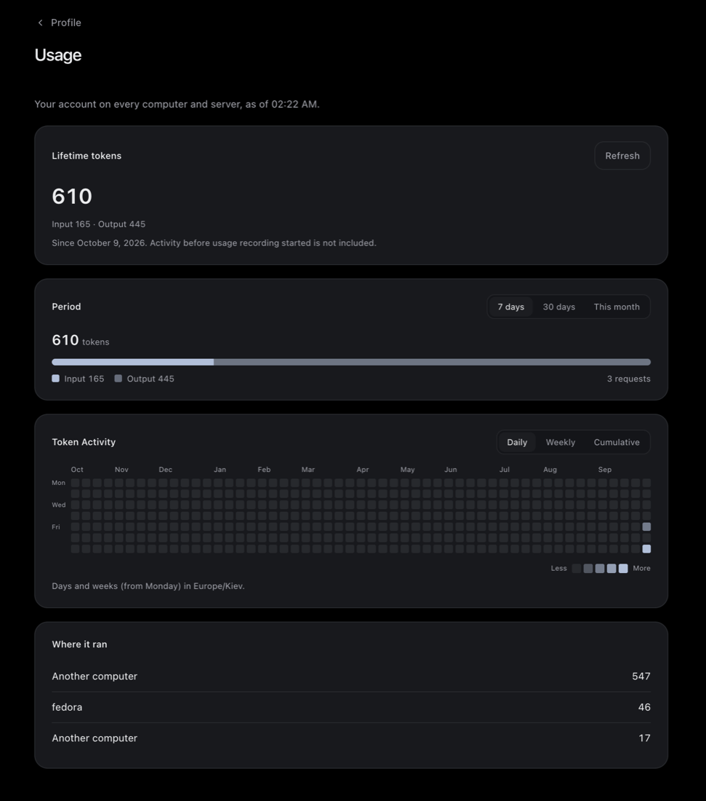

# Local Cognitive

A private AI workspace for chats, agents and workflows. Models run on your own computer, or on your own GPU server that you connect with one command. What you write stays on your machines unless you choose a cloud model.

**[Download the latest release](https://github.com/Ilyaberdar/local-cognitive-AI-system/releases/latest)**: macOS (Apple silicon), Windows (x64), Linux server (x64).



## What you get

- **Chats.** Use local GGUF models (built-in llama.cpp) or cloud models (OpenAI, Anthropic, Gemini), chosen per chat. You also get:
  - subagents you call with `@Name`;
  - debates with support, attack and judge roles;
  - a code mode with file tools and approvals.
- **Models.** A Hugging Face catalog that checks memory and disk before a download, and a library on your disk. Acceleration through Metal, Vulkan and CUDA, and models can be split across several GPUs.
- **Remote.** Work on your own GPU server from your laptop, wherever you are.
  - One command on the server prints a key; you paste it into the app.
  - The connection is encrypted end to end.
  - Work continues while the laptop sleeps.
- **Workflows and tasks.** A visual workflow builder, a task board, and daily or weekly schedules.
- **Synthesis.** Describe a module's contract in `.lcspec` and drive agents with `.lcflow`. The result is checked against the contract ([language guide](docs/lc-language.md)).
- **MCP and plugins.** Connect MCP servers (Blender, editors and more) and services: Notion, GitHub, Slack, Google Drive, Linear, Jira, Outlook, Teams and Dropbox.
- **Voice input.** Local dictation with whisper.cpp; audio never leaves the device.
- **Usage.** Tokens per day, per computer and per server.

## Screenshots

<table>
  <tr>
    <td width="50%"><br><b>Catalog.</b> Search Hugging Face GGUF models; memory and disk are checked before a download.</td>
    <td width="50%"><br><b>On device.</b> Your library: load, use in chat, set the default, add a vision adapter.</td>
  </tr>
  <tr>
    <td><br><b>Remote.</b> A paired GPU server: its version, CUDA, loaded models and current work.</td>
    <td><br><b>Workflows.</b> Agents, files and commands as steps, with a live console and agent activity.</td>
  </tr>
  <tr>
    <td><br><b>Tasks.</b> A board of tasks, each run by a workflow, with traces and schedules.</td>
    <td><br><b>Synthesis.</b> A contract, a flow that drives the agents, and every check they pass.</td>
  </tr>
  <tr>
    <td><br><b>Usage.</b> Tokens across your computers and servers.</td>
    <td></td>
  </tr>
</table>

## Install the app

### macOS (Apple silicon, macOS 13+)

1. Download `Local-Cognitive-<version>-arm64-mac.dmg` from the [latest release](https://github.com/Ilyaberdar/local-cognitive-AI-system/releases/latest).
2. Drag **Local Cognitive** to Applications.

The app is signed and notarized. New versions install from the app: use the update button in the title bar, or Settings → About.

### Windows (x64)

1. Download `Local-Cognitive-Setup-<version>.exe` and run it. It installs for your user only and needs no administrator rights.
2. The installer is not code-signed yet, so Windows SmartScreen warns once. Choose **More info → Run anyway**.
3. Models run on any GPU through Vulkan.
   - On a PC with an NVIDIA GPU, the app offers the faster CUDA build at first launch: about 515 MB, after NVIDIA's license.
   - If you skip it, the offer stays in Settings → Local Runtime.
4. The app tells you about new versions; install them from the releases page.

### First steps

1. **Models → Catalog.** Pick a model and a quantization. Start small (for example Qwen2.5 1.5B Instruct) and move up as memory allows.
2. Choose **Use in chat**, or **Set default** for new chats. A model loads on first use.
3. Optional: add cloud provider keys in Settings → Models & Providers, then connect MCP servers or plugins.
4. Sign in (Settings → Account) to use Remote and to see usage across your computers. Local chats and models work without an account.

## Your own GPU server

Run models on a Linux machine with NVIDIA GPUs and use it from your laptop, from anywhere.

### Requirements

- **Linux x64 with systemd.** Ubuntu 22.04+, Debian 12+, Fedora 36+ or Amazon Linux 2023, with glibc 2.34+, libstdc++ from GCC 12+ and OpenSSL 3.
- **Network.** Outbound HTTPS only. You don't open ports or need a domain or certificate.
- **NVIDIA GPU, optional.** It needs driver 570 or newer. The CUDA runtime covers Maxwell through Blackwell (compute capability 5.0 to 12.0).

### Install

```bash
curl -fsSL https://github.com/Ilyaberdar/local-cognitive-AI-system/releases/latest/download/install.sh | sudo bash
```

The installer:

- checks the release's Ed25519 signature and checksums;
- installs into `/opt/local-cognitive` with its own Node runtime;
- creates the service user `local-cognitive` and the data folder `/srv/local-cognitive`;
- installs the CUDA runtime when it finds an NVIDIA GPU, after you accept NVIDIA's license;
- starts the `local-cognitive` systemd service and prints the first connection key.

Options:

- `--cpu` skips CUDA;
- `--data-dir <dir>` changes the data folder;
- `--no-pair` skips the key;
- `--yes` answers every question with yes.

### Connect your computer

1. **On the server:** run `sudo local-cognitive-server pair`. It prints a one-time key that starts with `LCR1-…` and waits until a computer uses it. The key works once and expires after 10 minutes.
2. **In the app:** open **Remote → Connect a server**, paste the key and choose **Connect**. You need to be signed in.
3. **Ownership:** the first account that connects owns the server. Each further computer of the same account connects with a new key. Other accounts can't connect.

Then choose the server in the switch at the top right (**This computer** or your server). Chats, models, tasks and workflows then run there.

### Server commands

```bash
sudo local-cognitive-server            # the console: status, a live view and these commands
sudo local-cognitive-server pair       # a key for another computer of your account
sudo local-cognitive-server status     # running? reachable? CUDA or CPU, and why
sudo local-cognitive-server devices    # computers that can connect; revoke-device <id>
sudo local-cognitive-server update     # the newest signed release: backed up, rolled back if it fails
sudo local-cognitive-server rollback   # back to the previous release and its data
sudo local-cognitive-server cuda       # install the CUDA runtime later (driver 570+)
sudo local-cognitive-server logs | restart | stop | start
sudo local-cognitive-server uninstall  # removes the server and keeps its data
```

### How Remote stays private

- **The relay sees only encrypted bytes.** The app and the server connect through the relay of the Cloud API, inside TLS 1.3 with mutual authentication.
- **Trust comes from the key you paste.** It is pinned to the server's own key, which the connection key carries, not to a certificate authority.
- **The Cloud stores only account records.** It keeps accounts, servers, devices, permissions and token counts, never prompts, answers or files.
- **What a device can do.** Use chats, models, tasks, workflows, Synthesis, projects in shared folders, and the server's settings.
- **What stays on the server.** Anything set up there with full file access. A device can only delete, cancel or pause it.

## Models and GPUs

Every platform uses the same pinned llama.cpp build, b10809, verified by checksum.

| Platform | Acceleration |
| --- | --- |
| macOS, Apple silicon | Metal, unified memory |
| Windows x64 | Vulkan on any GPU; CUDA 13.3 or 12.4 on NVIDIA, installed from the app |
| Linux server x64 | CUDA 12.8 on NVIDIA (driver 570+), otherwise CPU |

**How models are placed:**

- Each loaded model runs in its own `llama-server` process on a loopback port with its own key.
- Loading a model never unloads another one.
- The app places a model on one GPU if it fits, on several GPUs if needed, or partly in RAM. If nothing fits, the error says what to unload or change.

**Several GPUs** (Models → GPUs):

- Different models run on different GPUs at the same time.
- A model too large for one GPU is split by layers (any GPUs) or by rows (CUDA, with a fast link between the cards).
- You can choose which GPUs models may use, pin a model to its own GPUs, and **Rebalance** the loaded models by the current settings.
- Splitting has not been validated on multi-GPU hardware yet.

**Formats:**

- Standard llama.cpp quantizations work, from F16 to the IQ and TQ types, including MXFP4 and models split into several GGUF files.
- Files made for a fork, such as Prism ML's PQ2_0, fail with a clear reason.

## Updates

- **App.** It checks 10–30 seconds after launch and then every 6 hours. A new version shows a button in the title bar and one system notification. You install it with a click, and the app restarts.
- **macOS** accepts an update only with the same Developer ID signature.
- **Windows** announces new versions and links to this page until the installer is code-signed.
- **Server.** It checks once a day and shows new versions in Remote. It installs nothing by itself.
  - `sudo local-cognitive-server update` verifies the signed manifest and backs up the data.
  - Then it switches the release and checks that the server is healthy; if it isn't, the update rolls back code and data on its own.

## Your data

| | App data | Installed app |
| --- | --- | --- |
| macOS | `~/Library/Application Support/Local Cognitive` | `/Applications/Local Cognitive.app` |
| Windows | `%LOCALAPPDATA%\Local Cognitive` | `%LOCALAPPDATA%\Programs\Local Cognitive` |
| Linux server | `/srv/local-cognitive` | `/opt/local-cognitive/current`, with previous releases kept for rollback |

- **Inside the data folder:** chats, memory, models, settings, and `app/runtime/host.db` (work in progress and the usage ledger).
- **Secrets** (provider keys, sign-in, Remote keys) are encrypted. On the desktop the key is kept by the system (Keychain on macOS). On a server it is kept in `/etc/local-cognitive/vault.key`.
- **Error reports and crash dumps** go to Sentry (EU region) only if you turn them on in Settings → Data & Privacy, with personal data removed. **Report a bug** sends what you write in it.

## Development

### Run from source

Requirements: Node.js 22.16+ and npm, plus CMake and a C++ compiler for the speech runtime.

```bash
npm ci
npm run prepare:llama     # the pinned llama.cpp for this machine
npm run prepare:speech    # whisper.cpp (desktop dictation)
npm run electron          # the desktop app
npm run dev               # or the browser UI at http://127.0.0.1:3000
```

Development runs keep their data in the operating system's user-data folder under `local-cognitive-ai-system`, separate from the installed app. The browser and headless runs read `.env`, while the desktop app keeps its settings in the app.

### Tests

```bash
npm test                                                     # the full suite
LLAMA_CPP_INTEGRATION=1 LLAMA_TEST_DATA_DIR=/tmp/llama-acceptance npm run test:llama   # real inference (downloads ~1.8 GB)
node scripts/test-server-install.mjs --distro fedora         # the server installer and updates in Docker systemd
```

### Builds and releases

- **macOS.** `npm run dist:mac:arm64` builds the dmg and the zip. For a signed build, set `CSC_NAME` to the Developer ID identity and `APPLE_KEYCHAIN_PROFILE` to a notarytool profile, then pass `-c.forceCodeSigning=true`. Before publishing, run `npm run verify:release -- --team-id <team>`.
- **Windows.** The **Windows installer** workflow in GitHub Actions builds the NSIS installer with the Vulkan llama.cpp and whisper.cpp. It checks the runtimes and their libraries, then runs a silent install and uninstall.
- **Server.** On Linux x64, `node scripts/pack-server.mjs --out release/server --url-base https://github.com/<repo>/releases/download/v<version>/` builds the tarball, `server-manifest.json` and `install.sh`. Sign the manifest with `node scripts/release-key.mjs sign release/server/server-manifest.json --key <private key>`.
- **CUDA for the server.** The **llama-cuda-runtime** workflow builds `libggml-cuda.so` for every NVIDIA architecture and publishes it as a prerelease that the manifest pins.

### Configuration for development and headless runs

The browser UI and the headless server read `.env` (see `.env.example`):

```env
HOST=127.0.0.1
PORT=3000
DEFAULT_PROVIDER=llamacpp        # or lmstudio, ollama, openai, anthropic, gemini
LMSTUDIO_BASE_URL=http://127.0.0.1:1234/v1
TELEGRAM_ENABLED=false
MCP_ENABLED=true
```

- **Cloud providers.** Add keys in Settings → Models & Providers and use **Test provider**. Local and cloud models can be mixed in one chat, for example a local supporter with a cloud judge.
- **Telegram (optional).**
  - Create a bot with `@BotFather` and set `TELEGRAM_ENABLED=true`, `TELEGRAM_BOT_TOKEN` and `TELEGRAM_OWNER_USER_IDS`.
  - The owner IDs are a comma-separated allowlist of numeric user IDs; only those users can use the bot.
- **MCP over stdio.** Other agents can call Local Cognitive as an MCP server. Run `npm run build`, then `npm run mcp:stdio`.
  - Tools: `local_ai_chat`, `local_ai_code`, `local_ai_hypothesis`, `local_ai_runtime_status`, `local_ai_list_models`, `local_ai_get_session_settings`, `local_ai_update_session_settings`.

### Chat access and approvals

Each chat has an access mode, set by the icon beside the model in the composer. Its agents follow the same mode.

| Mode | Reads inside the workspace | Writes inside the workspace | Delete, commands, outside paths |
| --- | --- | --- | --- |
| Ask for approval | allowed | ask | ask |
| Approve for me | allowed | allowed | ask |
| Full access | allowed | allowed | allowed |

- **The approval card** shows the exact paths, contents or command arguments. **Approve** runs that proposal once.
- **Prompts can't grant access.** Text in a prompt or an attachment never grants permission.
- **External writes always ask.** Writes through plugins need approval even with full access.
- **Not a sandbox.** Commands run with the app's operating-system permissions.

### Workflow tool nodes

Steps exchange structured output: reference an earlier step as `{{nodes.<node-id>.data.<key>}}`.

- **Search Files** and **Search Web**: SearXNG or Brave.
- **Save File** and **Run Command**: an executable plus an argument array, no shell. Both need full access to run unattended.
- **Decision**: emits `decision.true` or `decision.false`.

A run keeps a snapshot of its workflow, so later edits don't change it. A waiting run shows **Approve & continue** and **Reject** in its trace.

### Plugins and connected accounts

Settings → Plugins lists Notion, GitHub, Slack, Google Drive, Linear, Jira, Outlook Email, Outlook Calendar, Microsoft Teams and Dropbox.

- **How a plugin is enabled.** Install it, connect an account in the browser, choose read only or read & write, then enable it. Installing alone grants no access.
- **Account tokens** stay on the device, encrypted, and never reach the window, prompts or tool output.
- **Each write** needs a saved approval tied to the account.
- **OAuth client registrations** come from the distributor; see `electron/plugin-oauth-clients.example.json`. Packaged builds never include them, and `npm run verify:package-secrets` checks a build for credentials.

### Architecture

- **Components.** The desktop app runs its backend inside Electron's main process and draws the UI in an isolated window. The server is the same backend under systemd. The Cloud API (`apps/cloud`, Node 24 and Postgres 17) handles accounts, devices and the relay.
- **Remote** works over a catalog of operations (`src/runtime/operationCatalog.ts`), each request checked against its schema. Commands are written to the host's SQLite database before they are acknowledged.
- **Specifications:**
  - [Remote connection](architecture/remote-connection-implementation.md) (in Russian);
  - [llama.cpp integration](architecture/llama-cpp-integration-plan.md);
  - [Synthesis language](docs/lc-language.md).
- **Release notes:** [CHANGELOG.md](CHANGELOG.md).
